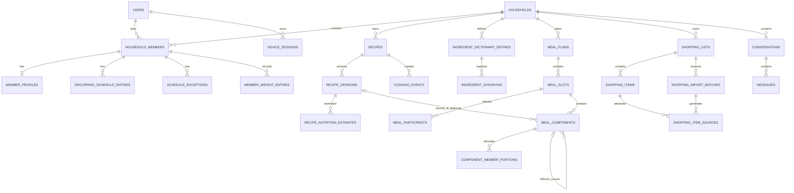

# Mise — Database Design Specification

**Version:** 1.1 — controlled amendment to frozen database-design baseline  
**Date:** 27 October 2026  
**Status:** **Frozen logical/schema design baseline**; not yet executable migrations. Milestone-specific SQL, constraints and measured indexing choices require implementation validation.  
**Source baselines:** Product Specification v2.1; Technical Architecture & Design v1.1; Design Review Feedback (26 October 2026); owner database-design decisions (27 October 2026)  
**Database:** PostgreSQL; **access/migrations:** Drizzle ORM + Drizzle Kit (ADR-002)

## 1. Purpose and scope

This document translates the **agreed P0 product requirements** into a proposed relational design. It defines data ownership, entity relationships, important columns, constraints, indexes, transaction boundaries, data retention, and an **incremental migration sequence A–D**. It is intentionally more concrete than the architecture specification but is **not yet an executable schema**. Data types, unique indexes, state-transition rules and unresolved alternatives are identified for review before coding.

**Principles**

1. One PostgreSQL database and one modular monolith; relational constraints protect essential invariants. No tenant-specific schema or database.
2. Use UUID identifiers, `timestamptz` for instants and `date` for calendar days. Household timezone is an IANA zone, initially `Europe/Helsinki`.
3. All household-scoped data is authorized in backend services, with household IDs and appropriate relational consistency checks. Never trust household IDs supplied by a browser or the LLM.
4. Recipe cooking content is **immutable per version**; mutable metadata (tags, notes, archive flag) lives on the recipe. Meal plan approval pins a cooking version and yield.
5. Keep **original recipe quantities and units**. Normalized ingredient keys and parsed numeric values are additional annotations, not replacements.
6. Persist approved business state in normal tables; chat history and AI proposals are never authoritative substitutes.
7. Nutrition calculations and shopping reconciliation use deterministic code; AI may propose or classify, but must not bypass validation.
8. Every multi-record mutation that represents one business action is transactional and retriable where appropriate.

### 1.1 Conventions

- Column names use `snake_case`; primary identifiers are PostgreSQL `uuid` (UUIDv4) unless explicitly stated; integer sequences/revisions remain numeric.
- Tables commonly contain `created_at timestamptz not null default now()`, and `updated_at` for mutable records.
- `revision bigint not null default 1` is an entity-specific optimistic concurrency token; it is **not** the shopping SSE cursor.
- Sensitive personal values are excluded from audit payloads, diagnostic logs and AI usage logs.
- Enumerated values below are **application/domain enums**; use either PostgreSQL enums or checked text following the migration strategy selected at implementation. Adding new states must be an explicit migration.
- Nullable is meaningful: `unknown`, `not provided` and `zero` are not interchangeable.
- Numeric amounts use PostgreSQL `numeric`, never floating-point for persisted recipe/shopping quantities.

## 2. Context and entity relationship overview



The diagram omits a few support tables for clarity (assets, import drafts, staples, nutrient references, category overrides, proposal records and audit/usage records). A component can be a pinned recipe **or** a standalone accompaniment, never both; component-specific checks enforce this.

## 3. Identity, household and access

| Table | Key columns | Constraints / notes |
|---|---|---|
| `users` | `id`, `oidc_issuer`, `oidc_subject`, `display_name`, `is_active` | Unique (`oidc_issuer`, `oidc_subject`); provisioned identities only. No Mise password hash. |
| `households` | `id`, `name`, `timezone` | Valid IANA timezone checked in app; initial household `Europe/Helsinki`. |
| `household_members` | `id`, `household_id`, `user_id`, `role`, `joined_at` | Unique (`household_id`, `user_id`). P0 supports two provisioned members; don't hard-code member columns. |
| `device_sessions` | `id`, `user_id`, `token_hash`, `device_label`, `created_at`, `last_seen_at`, `authenticated_at`, `idle_expires_at`, `absolute_expires_at`, `revoked_at` | Unique token digest, revoke individually; sessions checked on every authorized request and SSE stream. Never persist bearer token plaintext. `authenticated_at` records the **verified fresh OIDC authentication time** from validated identity evidence at creation; it is not a substitute for server-side freshness checks. New device sessions must not silently reappear after revocation via Authelia SSO reuse. |

**Authorization invariant:** all shared records belong to a household; a request must resolve the authenticated user and membership before reading or writing. Where joins cross household-scoped tables, prefer composite foreign keys containing `household_id` or equivalent service checks plus DB constraints to prevent cross-household references. This is **not** a proposal for full PostgreSQL row-level security in P0.

## 4. Profiles, preferences and schedules (Milestone C)

| Table | Proposed core columns | Notes |
|---|---|---|
| `member_profiles` | `household_member_id PK`, `birth_year smallint`, `height_cm numeric?`, `activity_level`, `goal_type`, `goal_parameters jsonb`, `dietary_restrictions jsonb`, `food_preferences jsonb`, `revision` | Both household members may view complete profiles (confirmed). Store only values needed for planning; allow edits and unknowns. |
| `member_weight_entries` | `id uuid`, `household_member_id`, `measured_on date`, `weight_kg numeric`, `created_at` | Dated weight history, immutable or correction-audited; most recent dated entry is used for energy calculations. Multiple readings per day may be supported via timestamp/tie-breaker; do not silently overwrite records. Simple entry P0, charts P1. |
| `household_preferences` | `household_id PK`, `preferences jsonb`, `planning_defaults jsonb`, `revision` | Shared food preferences, effort limits, usual meals and general rules. |
| `recurring_schedule_entries` | `id`, `household_member_id`, `kind`, `weekday smallint`, `local_start_time?`, `local_end_time?`, `valid_from date?`, `valid_until date?`, `attendance_effect?`, `metadata jsonb` | Weekday ISO 1–7. Office lunch, exercise and unavailability. No row = unknown, not necessarily available. |
| `schedule_exceptions` | `id`, `household_member_id`, `local_date`, `action`, `recurring_entry_id?`, `kind`, `times?`, `attendance_effect?`, `details` | Cancel/replace/add occurrence without changing recurrence; explicit reference for cancellation/replacement. |
| `member_energy_targets` | `id`, `household_member_id`, `effective_date`, `kcal_target numeric?`, `method`, `method_version`, `assumptions jsonb`, `source_profile_revision`, `is_manual_override`, `computed_at` | Reproducible derived daily target. No fabricated value if inputs inadequate. Consider retention policy for past estimates. |

**Resolved:** store birth year only, and retain dated weight history rather than a single mutable weight on the profile. Age is approximate until the exact birthday is known; use the most recent weight observation available as of the target-calculation date. Goal data must not imply a diagnosis. Exercises must not be double-counted when calculating activity multipliers.

## 5. Recipes, immutable versions and cooking history (Milestones A–B)

### 5.1 Primary tables

| Table | Proposed core columns | Constraints / behavior |
|---|---|---|
| `recipes` | `id`, `household_id`, `current_version_id?`, `title`, `description?`, `tags text[]`, `general_notes?`, `archived_at?`, `source_type?`, `source_url?`, `search_document ...`, `search_text`, `revision` | Shared household canonical record; metadata changes do not create cooking revisions. Version pointer initialized in same transaction as version 1. |
| `recipe_versions` | `id`, `recipe_id`, `version_no int`, `schema_version int`, `content jsonb`, `created_by_member_id`, `change_reason?`, `created_at` | Unique (`recipe_id`, `version_no`); contents immutable after insert; retain older versions indefinitely while referenced. |
| `cooking_events` | `id`, `household_id`, `recipe_id`, `recipe_version_id?`, `meal_slot_id?`, `household_member_id`, `cooked_on date`, `tested boolean`, `rating smallint?`, `note?` | Check rating 1–5 or NULL; personal ratings attributed to a member. Slot may be absent for ad hoc cooking. |
| `assets` | `id`, `household_id`, `storage_key`, `original_filename?`, `display_filename`, `mime_type`, `byte_size`, `sha256`, `kind`, `retention_mode`, `created_at` | Retained files on a private persistent filesystem. Suggested stable slug + unique identifier (e.g. `makaronilaatikko_a82f31.jpg`); `storage_key` is authoritative, not user-provided filename. Source images transient by default; retained only if user opts in. |
| `import_drafts` | `id`, `household_id`, `created_by_member_id`, `input_kind`, `source_url?`, `source_text?`, `asset_id?`, `draft_json`, `draft_schema_version`, `uncertainties jsonb`, `state`, `revision`, `saved_recipe_id?` | Draft/review/approved/discarded; explicit save approval; deduplicate save retries. |

**Circular current-version pointer:** define `recipes` first with nullable `current_version_id`; insert recipe/version atomically, update pointer; ensure referenced version belongs to the same recipe via a composite FK/constraint or validated DB trigger. A recipe must have a current version when exposed as active. Never blindly point to a different recipe's version.

**Retained image filename example:** `makaronilaatikko_a82f31.jpg`. Normalize and sanitize the recipe-name slug, append a sufficiently collision-resistant unique ID, and keep the filename fixed even if the recipe title changes. The relative path stored in `assets.storage_key` is authoritative.

### 5.2 Version content contract (JSONB)

This is a **shape illustration** rather than the complete Zod/JSON Schema. The actual schema must be versioned and validated on write.

```json
{
  "schema_version": 1,
  "yield": {"quantity": "4", "unit": "servings"},
  "ingredient_groups": [{"id": "group-1", "name": "Sauce", "order": 1}],
  "ingredients": [{
    "id": "line-uuid", "group_id": "group-1",
    "display_name": "tomaattimurska", "normalized_key": "tomaattimurska",
    "original_quantity_text": "1 prk", "amount_min": "1", "amount_max": "1",
    "original_unit": "prk", "canonical_unit_code": "package",
    "preparation_note": null, "scale_policy": "linear",
    "alternatives": [], "uncertainties": ["Package mass not specified"]
  }],
  "instructions": [{"id": "step-uuid", "order": 1, "text": "..."}]
}
```

For **unit conversion**, only dimension-compatible, known conversions are allowed (kg→g, dl→ml, rkl/tl→ml using the configured unit table). Mass, volume and count cannot be equated without an explicit ingredient-specific conversion. Ranges remain ranges. `to_taste` and `not_scalable` are not multiplied mechanically. Original input is preserved even when normalized fields are added.

**Immutability enforcement:** service layer prevents updates; consider a database trigger disallowing UPDATE/DELETE to version cooking content, while supporting carefully controlled migration tooling. Restoring an old version creates a new version. Existing planned meals do not follow later canonical changes.

### 5.3 Search projection

Keep a same-transaction current-version search projection on `recipes`—title, current-version ingredients, instructions, and mutable notes. Exact physical implementation remains subject to ADR-010 spike: choose `tsvector` populated by app/trigger or generated columns from a stable flattened text column; generated columns **cannot directly read a different table's JSONB**. A Finnish `tsvector` index plus `simple` text representation and `pg_trgm` index are candidates. Do not index every historical version for default searches.

Ranking order: exact/title match → ingredient → directions/notes; fallback matches support typo and some compounds. Treat ä and ö as distinct in primary Finnish search. Golden test corpus (~30 pairs) must include English words, inflections and compounds.

### 5.4 Rating filter semantics

The product requires rating filters but does not settle personal-rating aggregation. **Proposed default:** show household aggregate of recorded event ratings, with an option to filter by member; compute dynamically first, or create a materialized summary only if needed. A zero-rating count is **unrated**, not 0/5.

## 6. Nutrition reference, ingredient matching and cached estimates (Milestone C)

| Table | Proposed core columns | Notes |
|---|---|---|
| `nutrition_dataset_versions` | `id`, `provider` (`fineli`/other), `version_label`, `source_uri`, `license`, `attribution_text`, `imported_at`, `is_active` | Reproducibility; imported Fineli data is versioned, not an uncontrolled live lookup. |
| `nutrition_foods` | `id`, `dataset_version_id`, `external_food_id`, `name_fi`, `name_en?`, `energy_kcal_per_100g?`, `other_values jsonb` | Unique source+external ID per dataset; nullable values where source incomplete. |
| `ingredient_nutrition_matches` | `id`, `recipe_version_id`, `ingredient_line_id`, `nutrition_food_id?`, `mass_g_min?`, `mass_g_max?`, `match_method`, `confidence?`, `reviewed_by?`, `warning?` | References JSON ingredient ID by convention; validated against immutable content by application code. |
| `recipe_nutrition_estimates` | `id`, `recipe_version_id`, `dataset_version_id?`, `method`, `energy_total_min_kcal?`, `energy_total_max_kcal?`, `energy_per_serving_min_kcal?`, `energy_per_serving_max_kcal?`, `coverage_ratio?`, `reliability_level?`, `warnings jsonb`, `input_fingerprint`, `is_manual_override`, `created_at` | Cached estimate with provenance; multiple calculations over time permitted, one active estimate selected in service. |
| `ingredient_dictionary_entries` | `id`, `household_id?`, `normalized_key`, `canonical_label_fi`, `ingredient_kind?`, `created_at`, `revision` | Stable canonical identity; avoid collapsing non-equivalent foods, e.g. light cream vs regular cream. System-supplied or household-specific records, with explicit precedence. |
| `ingredient_synonyms` | `id`, `ingredient_dictionary_entry_id`, `synonym`, `language`, `match_origin`, `confidence?`, `reviewed_at?` | Uniqueness by scope and normalized synonym where unambiguous; proposed AI matches may remain unconfirmed. Ambiguous names remain separate. |
| `household_ingredient_settings` | `household_id`, `normalized_key`, `is_staple`, `shopping_category_id?`, `preferred_label?`, `revision` | Composite PK. Ingredient household rules affect shopping and grouping, not original recipe text. |
| `shopping_categories` | `id`, `household_id?`, `name`, `sort_order`, `is_system_default` | Category fallback `Other`; configurable household overrides. |

**Hybrid calculation contract:** deterministic target calculation from documented adult estimation method and configured conservative safeguards; never let the LLM override limits. Automatic best-effort nutritional matching uses imported/reference data; unmatchable or ambiguous items produce warnings and possibly `NULL` energy. Manual override is available but not mandatory. Derived targets and recipe estimates are presented as estimates, not medical facts. Portion arithmetic must not silently manufacture ingredient calories when amounts or package sizes are unknown.

**Confirmed nutrition uncertainty display:** show one approximate kcal/serving estimate with a reliability indicator; store coverage, reasons for uncertainty, ingredient-level assumptions and any defensible lower/upper bounds internally. Where coverage is too poor, do not display an apparently precise value. Correction is optional, never a blocker for recipe import.

**Open technical detail:** how to represent loss/retention in cooking (e.g., boiling pasta) and whether ingredient weights are raw/finished. Initially, document the chosen approximation and uncertainty rather than implying precision.

## 7. Meal planning, version pinning, participants and leftovers (Milestone C)

| Table | Proposed core columns | Constraints / behavior |
|---|---|---|
| `meal_plans` | `id`, `household_id`, `start_date`, `end_date`, `status`, `revision`, `approved_at?`, `approved_by_member_id?` | `end_date >= start_date`; any seven-day window or partial use within; archive as state change. |
| `meal_slots` | `id`, `meal_plan_id`, `local_date`, `slot_type`, `slot_order`, `status`, `revision`, `notes?` | Default five slot types, but multiple slots per type/date are allowed. Stable UUID and `slot_order` determine presentation order; no unique constraint on (plan, date, type). No recipe or leftover source pointer on slot. |
| `meal_participants` | `id`, `meal_slot_id`, `household_member_id`, `attendance`, `away_energy_estimate_kcal?`, `away_energy_override_kcal?` | Unique (`meal_slot_id`, `household_member_id`); one of home/away/not_eating/unknown. |
| `meal_components` | `id`, `meal_slot_id`, `component_type`, `display_order`, `label`, `recipe_id?`, `recipe_version_id?`, `base_yield?`, `target_yield?`, `simple_amount?`, `simple_unit?`, `leftover_source_component_id?`, `leftover_quantity?`, `leftover_unit?`, `planned_leftover_servings?`, `revision` | For recipe components, version and yield are pinned at plan approval; for accompaniment, no recipe ID/version. For leftovers, link to a specific earlier component (same household), not its entire slot; validate available and consumed quantities and reject cycles. Allow multiple components per slot. |
| `component_member_portions` | `id`, `meal_component_id`, `household_member_id`, `serving_equivalents?`, `practical_amount?`, `practical_unit?`, `estimated_energy_kcal?`, `is_override`, `note?` | Unique (`meal_component_id`, `household_member_id`); only home participants receive cooking portions, unless explicitly overridden. |
| `meal_plan_proposals` | `id`, `meal_plan_id`, `source_conversation_id?`, `base_plan_revision`, `proposal_json`, `state`, `created_by_member_id`, `created_at`, `resolved_at?` | Stale proposals fail apply; rejected/expired proposals never alter approved plan. |

### 7.1 Approval and pinned version invariant

- Draft components may follow current canonical recipe and do **not** pin a cooking version yet.
- During approval, lock and re-read all referenced recipes; resolve exactly which current versions are approved, record `recipe_version_id`, `base_yield`, `target_yield`, member portions and relevant calculation assumptions in one transaction; reject or request review when a recipe changed unexpectedly.
- After approval, a canonical recipe edit **does not mutate** the approved component. UI may notify of a newer version and offer an explicit slot update.
- Changing an approved component creates a new **plan revision**, updates planned quantities explicitly, and marks linked shopping-import batches stale. Preserve an audit trail of change; do not create full weekly-plan snapshot tables in P0: structured audit events with revision identifiers suffice.
- `leftover_source_component_id` references the specific source component, not an entire meal. Enforce same-household linkage, earlier-preparation ordering, no cycles, and allocated-leftover quantity not exceeding available prepared leftovers in a guarded transactional service. A meal may mix leftover main dish with fresh sides.

### 7.2 Portion/yield reconciliation

For freshly cooked recipe components, the sum of per-member base-serving equivalents **plus any intentionally retained leftover quantity** should approximately equal the approved target yield, with tolerances and explicit exceptions. This requires a quantity for planned leftovers—not just a link; **proposed addition:** `planned_leftover_servings numeric?` on recipe components. For recipe-free sides, retain e.g. `10 cherry tomatoes` or `5 cm cucumber` per person, without forcing a recipe-serving equivalent. Display portion measures in practical units when possible without rewriting canonical recipe units.

### 7.3 Plan history and away meals

Approved-plan edits create structured `audit_events` recording actor, time, entity, before/after relevant changes and plan revision identifiers, excluding unnecessary sensitive data. Source records plus revisions support shopping reconciliation; reconstructing a full historical calendar UI is not a P0 requirement.


`away` means no home cooking portion by default but contributes a configurable estimated kcal to that member's daily plan. Store optional corrected energy value; do not require a meal diary. Absence and skipped meals are distinct.

## 8. Shopping lists, generation, real-time sync and reconciliation (Milestones A and D)

| Table | Proposed core columns | Constraints / behavior |
|---|---|---|
| `shopping_lists` | `id`, `household_id`, `name`, `status`, `change_seq bigint`, `created_by_member_id`, `revision` | Independent of plans. `change_seq` increments on list-item state changes for SSE; never used as edit revision. |
| `shopping_items` | `id`, `shopping_list_id`, `origin`, `name`, `normalized_key?`, `amount_min?`, `amount_max?`, `unit_code?`, `original_quantity_text?`, `category_id?`, `picked boolean`, `picked_at?`, `picked_by_member_id?`, `user_modified boolean`, `revision`, `created_at` | Separate user and generated rows. Explicit desired-state checkoff. Updates to unrelated items must not conflict. |
| `shopping_import_batches` | `id`, `shopping_list_id`, `meal_plan_id`, `source_plan_revision`, `state`, `import_key`, `created_by_member_id`, `created_at`, `reconciled_at?` | Uniqueness/idempotency per intentional operation; reimport after plan modification is **reconciliation**, not blindly a new batch. |
| `shopping_item_sources` | `id`, `shopping_item_id`, `shopping_import_batch_id`, `meal_slot_id?`, `meal_component_id?`, `recipe_version_id?`, `ingredient_line_id?`, `amount_min?`, `amount_max?`, `unit_code?` | Many contributions → one generated row. Recipe-free accompaniments have no recipe/line ID. |
| `shopping_excluded_staples` | `id`, `shopping_import_batch_id`, `normalized_key`, `label`, `amount?`, `unit?`, `source_ref jsonb` | Explicit review/audit of skipped staples, not deleted information. |
| `shopping_reconciliation_proposals` | `id`, `shopping_import_batch_id`, `source_plan_revision`, `diff_json`, `state`, `created_at`, `resolved_at?` | Proposals reviewed before applying changes to picked/user-modified lines. |

### 8.1 Generation and merge rules

1. Generate only from approved/pinned plan components and their target quantities, including recipe-free accompaniments.
2. Within one import batch, combine identical **normalized keys** only where units are dimension-compatible and reliable conversions are defined; retain all `shopping_item_sources` contributions.
3. **Never automatically merge** manual items with generated items. Separate import batches remain separate by default, with advisory similarity cues.
4. No count↔mass↔volume conversions by guess. Retain units or split rows when needed.
5. Household-marked staples are excluded from generated rows but displayed in collapsed review.
6. Once a row is picked, do not silently unpick. A newly required extra quantity becomes a new unpicked row; reductions/removals are reviewable.
7. User-modified generated rows are preserved during reconciliation and explicitly flagged for review.
8. Retrying the **same command** with the same idempotency key returns its prior outcome. A distinct new plan import is a separate batch even if ingredient names match.

### 8.2 Concurrency/SSE transaction

Checkoff command is `setPicked(itemId, desiredState)`, not toggle. On successful state change, in one transaction: mutate `shopping_items`, set attribution/time, increment `shopping_lists.change_seq`, commit, then signal SSE `{listId,seq}`. Snapshot refetch is authoritative; clients resync after reconnect/resume. For quantity/name changes use item `revision` as `If-Match` token; return `409` on stale writes. Checkoffs use server last-write-wins as approved in ADR-013. Do not require every item edit to increment all other item revisions.

**P0 is online + reconnection synchronization.** Persisted offline mutation queues are P1.

## 9. AI conversation, proposal, provenance, auditing

| Table | Proposed core columns | Notes |
|---|---|---|
| `conversations` | `id`, `household_id`, `created_by_member_id`, `workflow` (`planner`/`importer`), `title?`, `status`, `deleted_at?`, `created_at`, `updated_at` | Retained until explicitly deleted; no automatic age expiry. Chat type controls tool permissions; independent of business approvals. |
| `messages` | `id`, `conversation_id`, `sender_type`, `sender_member_id?`, `provider_identifier?`, `model_identifier?`, `content_parts jsonb`, `tool_events jsonb?`, `sequence_no`, `created_at` | Canonical Mise roles/text/image references/tool events, **not raw vendor message payloads**. Unique conversation+sequence; provider/model only on AI-generated entries. Redact secrets and avoid duplicating sensitive profile snapshots. |
| `ai_usage_records` | `id`, `household_id`, `workflow`, `provider_identifier`, `model_identifier`, `input_tokens?`, `output_tokens?`, `usage_details jsonb?`, `estimated_cost?`, `currency?`, `latency_ms?`, `status`, `created_at` | Nullable fields when provider omits metrics; store provider-reported usage details separately from normalized totals; no raw prompts by default. |
| `audit_events` | `id`, `household_id`, `actor_member_id?`, `action`, `entity_type`, `entity_id`, `summary jsonb`, `created_at` | Minimal structured attribution for changes; avoid storing raw weight, image content or session tokens. |
| `idempotency_keys` | `id`, `household_id`, `actor_member_id`, `operation`, `request_key`, `request_hash`, `result_ref jsonb`, `created_at`, `expires_at` | Unique actor+operation+key; reject same key reused for different payload. |

Conversation deletion removes or schedules deletion of messages and conversation-specific attachments, but must never cascade to saved recipes, plans or other domain records. Both members may manage conversations they are authorized to access.

The server assembles AI context deterministically from **authorized** household and profile data, sends only derived targets or necessary restrictions where feasible, checks plan `base_plan_revision`, validates tool outputs with Zod and applies confirmed changes via services. Keep external AI response retention separate from Mise's own conversation storage; use no-store / retention-minimizing options where the adapter supports them. No vector DB or user-uploaded AI document UI in P0.

**Provider-neutral storage invariants:** `provider_identifier` and `model_identifier` are opaque stable strings (not vendor enums or database foreign keys tied to one API). Persist Mise-owned message/content-part schema versions so future adapters can read old conversations. Message tool events use Mise tool names, validated arguments and outcomes; vendor tool-call IDs may appear only in optional diagnostic metadata. Keep raw vendor requests/responses out of canonical tables. Existing conversation history must remain readable after changing providers; resuming an opaque vendor conversation ID is not required. The interface and storage contract is implemented with the first AI workflow in Milestone B, while conversation/planner tables may remain a Milestone D migration.

## 10. Relationship and integrity controls

### 10.1 Required uniqueness / referential integrity

- `recipe_versions(recipe_id, version_no)` unique; `recipes.current_version_id` must belong to same recipe.
- `meal_participants(meal_slot_id, household_member_id)` unique; no unique index on slot type per day, to permit extra snacks. Same for `component_member_portions(meal_component_id, household_member_id)`.
- `household_members(household_id, user_id)` unique; `users(oidc_issuer, oidc_subject)` unique.
- `meal_components` recipe/simple discriminator enforced with CHECK; **draft recipe components may have null version**, approved components may not.
- Cooking event rating must be 1–5 or null; nonnegative quantities and calorie values where numeric.
- Shopping item origin (`user`/`generated`) drives permitted references; generated rows should have source provenance, except specifically documented manual-merge/adjustment cases.
- `shopping_items.revision` and list `change_seq` are nonnegative and monotonically increasing in write code.
- Full household consistency of nested references should be enforced through a combination of composite FKs, guarded insert/update services and tests; do not rely only on client input.

### 10.2 Cascades and delete policy

- Prefer **restrict / soft-archive** for recipes, approved plans, shopping imports and any version referenced by historic records.
- Deleting a draft may cascade to temporary, unreferenced attachments subject to retention; never cascade into a referenced canonical recipe.
- User/member removal is an explicit administrative workflow, not an uncontrolled cascade across shared household data.
- Include a deliberate **household export and eventual data-erasure** procedure, with retention exceptions documented.

## 11. Proposed indexes and query paths

| Access path | Index candidate |
|---|---|
| Household recipe listing | `recipes(household_id, archived_at, title)` |
| Current recipe version | `recipe_versions(recipe_id, version_no desc)` unique/index; pointer PK lookup |
| Finnish text search | GIN over Finnish search vector; separately indexed trigram (`pg_trgm`) fallback |
| Recent cooking and rating filter | `cooking_events(household_id, cooked_on desc)` and `(recipe_id, household_member_id, cooked_on desc)` |
| Latest recorded weight | `member_weight_entries(household_member_id, measured_on desc, created_at desc)` |
| Ingredient synonyms | indexed normalized synonym + language / dictionary scope; ambiguous matches require disambiguation |
| Component-level leftovers | `meal_components(leftover_source_component_id)` (partial index when nonnull) |
| Schedules for a member | `recurring_schedule_entries(household_member_id, weekday)`; `schedule_exceptions(household_member_id, local_date)` |
| Plans by household/week | `meal_plans(household_id, start_date desc)` |
| Slots by date and sequence | `meal_slots(meal_plan_id, local_date, slot_order)` |
| Shopping list and items | `shopping_items(shopping_list_id, picked, created_at)`; `shopping_lists(household_id, status)` |
| Sources and reconciliation | `shopping_item_sources(shopping_import_batch_id, shopping_item_id)`; `shopping_import_batches(meal_plan_id, state)` |
| Messages | `messages(conversation_id, sequence_no)` unique |
| Device-session validation | `device_sessions(token_hash)` unique; expiry/revocation maintenance index |
| Dataset lookups | `nutrition_foods(dataset_version_id, external_food_id)` unique; normalized-name index when validated |

Index details should be adjusted against actual `EXPLAIN (ANALYZE, BUFFERS)` results, but the projected volume is small. Partial indexes and expression indexes may be written as explicit SQL migrations managed alongside Drizzle Kit.

## 12. Transaction boundaries and concurrency matrix

| Operation | Atomic write set | Protection |
|---|---|---|
| Create recipe | `recipes` + initial `recipe_versions` + search projection | idempotency key, FK/pointer invariant |
| Revise recipe | new version + current pointer + recipe revision + search projection | expected current version; `409` if stale |
| Approve import | draft approval + recipe creation + provenance | expected draft revision, explicit confirmation, idempotency |
| Approve plan | plan status + each recipe component's pinned version/yield + individual portions | plan revision and recipe revalidation under transaction |
| Edit approved planned occurrence | changed component/portion + plan revision + mark import stale | expected plan/component revision; audit |
| Create shopping import | batch + consolidated items + source contributions + staple exclusions + list seq | idempotency; merge only within batch |
| Reconcile plan import | approved diff + item/source changes + batch source revision + seq | do not overwrite picked/user-modified lines |
| Check off item | item picked state + picked attribution + list seq | desired-state, server ordering; SSE after commit |
| Change user-item details | item + revision + list seq | expected item revision; stale=409 |
| Revoke device | session revocation timestamp | subsequent requests and SSE rejected/closed |

**Concurrency footnote:** `If-Match` should use a stable version serialization and distinguish conflict (`409`) from unmet HTTP precondition (`412`) consistently; pick one public API convention before OpenAPI generation. Never hold a database transaction open across an AI-provider request.

## 13. Export, backup, retention and migrations

- **Portable export (P0):** at minimum recipes in JSON and Markdown, with references to version history as appropriate; structured exports for other household entities must be defined. Do not rely solely on PostgreSQL dump as the user-facing export.
- **Operations backup:** nightly encrypted off-host PostgreSQL dump plus the private persistent image directory and separate Authelia config/state; recovery objective RPO 24h, RTO a few hours. Regular restore into scratch environment with integrity/smoke tests.
- **Image naming/storage:** preserve a stable relative `storage_key` and separate safe readable `display_filename`, derived from a normalized recipe-name slug plus unique suffix. Strip path separators/control characters; do not use client-supplied paths. A recipe rename does not automatically rename the image. Source images normally expire after extraction unless retention is opted in. Backup and restore both DB and files as a coherent set.
- **Secrets:** never in database dump exports intended for household use; device token digests and identity secrets require separate security handling.
- **Drizzle migrations:** version-controlled and applied once as part of deployment; use explicit SQL for PostgreSQL extensions, search triggers/expressions and specialized constraints where needed. Prefer additive migrations and data backfills over editing previously applied migration history.
- **Immutable JSON compatibility:** retain `schema_version`; older content parsed by corresponding decoder. Any historical backfill must retain original content and avoid rewriting source facts.

## 14. Milestone-oriented migration plan

| Stage | Tables / foundational objects | Acceptance gate |
|---|---|---|
| **A — Everyday use** | users, households/members, sessions; recipes/versions, household ingredient settings (at least staples/category scaffolding), shopping lists/items/categories, audits/idempotency; search indexes; backup | Two authenticated members share recipes and synchronized lists, search/scale recipes, revoke devices and restore backups. |
| **B — Import** | assets, import_drafts, cooking_events and importer provenance | URL/text/photo creates reviewed draft; confirm saves one recipe on retry; personal ratings recorded. |
| **C — Manual planning** | profiles, dated member weights, household preferences, schedules/exceptions, energy targets, nutrition data/estimates, meal plans/slots/participants/components/portions | Approved week pins recipe versions and yields, handles away lunches, leftovers and practical sides; deterministic targets verified. |
| **D — AI planning + plan-to-list** | persistent planner conversations/messages, plan proposals, shopping batches/sources/exclusions/reconciliation, AI usage (introduce shared provider-neutral AI storage already in B if importer conversations need it) | Validated AI proposals; one batch combines compatible sources but not user items; plan changes reconcile safely. |

**Important caveat:** schema design should anticipate D when creating A tables, but **do not deploy all D columns/tables prematurely**. Stage A shopping items should already have enough origin/revision fields to avoid destructive migration in D.

## 15. Resolved owner decisions and remaining engineering validations

### 15.1 Ten owner decisions — confirmed 27 October 2026

| # | Topic | Decision and schema consequence |
|---|---|---|
| 1 | Age and weight | `member_profiles.birth_year`; dated `member_weight_entries`; latest applicable reading feeds deterministic targets. Simple weight entry P0; charting P1. |
| 2 | Meal slots | Five default types, but allow multiple instances per type/date; stable UUIDs and `slot_order`, no restrictive unique (date, type). |
| 3 | Leftovers | `meal_components.leftover_source_component_id` targets a specific earlier component, with quantity allocation; do not link leftovers at whole-slot level. |
| 4 | Plan history | Maintain plan revisions and structured audit events; no full historical weekly-plan snapshots in P0. |
| 5 | Nutrition uncertainty | Show a single approximate energy value and reliability indicator when defensible; store assumptions, coverage, warning and optional calculated range; flag unreliable estimates. |
| 6 | Ingredient normalization | Persistent canonical ingredient dictionary and synonym mappings, with AI-assisted best-effort proposals and optional user corrections. Ambiguous/distinct ingredients remain separate. |
| 7 | Shopping synchronization | Per-item `revision` for edit conflicts, list `change_seq` for SSE cursor, explicit desired-state checkoff. |
| 8 | Retained images | Private filesystem; human-readable stable filename from recipe-name slug plus unique suffix; DB stores authoritative relative path and metadata; transient images discarded by default. |
| 9 | Conversations | Retain until explicitly deleted; deletion must not remove persisted recipe/plan state. |
| 10 | Primary keys | PostgreSQL UUIDv4 for record primary keys; integers for ordered revisions and sync sequences. |

### 15.2 Engineering detail still to validate (not reopened product decisions)

1. **Fineli data spike:** import shape, official IDs, licensing attribution, safe nutrition matching and raw/cooked weight assumptions; calibrate confidence/reliability thresholds and adult safety limits.
2. **Search and Drizzle spikes:** exact SQL/index strategy for Finnish/English full-text and trigram search; PostgreSQL-specific migrations, compound foreign keys and pointer validation.
3. **Recipe ratings:** default aggregation of personal ratings (proposed household average with member filter) is still an implementation UX default, not among the ten confirmed decisions.
4. **Sessions:** Validate Authelia passkey/password+TOTP compatibility, verified fresh authentication (`max_age=0` with checked ID-token `auth_time`, or tested equivalent), SSO reuse after Mise device-session revocation, and idle/absolute expiration figures before public Milestone A use. Recovery covers relevant Authelia sessions and credentials as well as Mise device sessions.
5. **Source text retention:** clarify when saved import source text remains available; retained source images follow opt-in rule.
6. **Unit conversion and matching:** confirm constants for Finnish units, handling of ambiguous package sizes, and synonym precedence; never invent mass↔volume conversions.
7. **Manually merged shopping origins:** persist explicit provenance when a user elects to merge distinct origin rows; never auto-merge manual and generated items.
8. **Operational details:** validate file/database backup consistency, atomic asset write/delete lifecycle and UUIDv4 generation strategy.

These items should be resolved with implementation spikes and tests, not by reopening the agreed ten owner decisions.

## 16. Suggested validation spikes and first implementation artifacts

1. **Drizzle/PostgreSQL spike (ADR-002):** create a minimal `recipes`/`recipe_versions` slice, transaction, compound FK/pointer constraint, custom SQL migration, rollback and drift check.
2. **Finnish search spike (ADR-010):** sample multilingual recipes, 30 golden query/recipe pairs, Finnish/`simple` full-text plus `pg_trgm`, observed ranking and compound handling.
3. **Fineli data spike (ADR-007):** verify chosen dataset fields, license/attribution, energy unit consistency, matching examples and ambiguity policy; write a deterministic estimation fixture.
4. Define shared **Zod contracts** and derive OpenAPI for recipe, plan, shopping and auth administration endpoints.
5. Create migration `0001` for Milestone A after reviewing this document and **A-specific** Drizzle/search, auth, ingredient/shopping-origin, and API/idempotency validation. Do **not** block `0001` on the Milestone C Fineli/nutrition spike or Milestone B AI-provider budget.

## 17. Requirements and ADR traceability

| Domain | Primary requirements | Architecture decisions |
|---|---|---|
| Recipes and versions | FR-01–07, FR-28 | ADR-002, 005, 010, 015 |
| Import and suggestion | FR-10–16 | ADR-006, 008, 015 |
| Profiles/nutrition/schedules | FR-17–19B, FR-26, FR-29 | ADR-007, 014, 016 |
| Plans/portions | FR-20–25, FR-28 | ADR-005, 014, 016 |
| Shopping and sync | FR-34–39 | ADR-004, 013, 015, 017 |
| Shared access and export | FR-30–32; security NFRs | ADR-003, 009, 012 |

## 18. Change history

| Version | Date | Notes |
|---|---|---|
| v0.1 | 2026-10-27 | First logical/physical draft grounded in Product v1.4 and Technical Architecture v0.5. No product changes made. |
| v0.2 | 2026-10-27 | Incorporated all ten owner decisions; refined profiles/weight history, flexible slots, component leftovers, plan audit, nutrition uncertainty, ingredient dictionary, shopping sync, image storage/naming, conversation retention and UUID identifiers. Identified remaining technical validations separately. |


| v1.1 | 2026-10-27 | Controlled ADR-008 provider-independence amendment: provider/model usage identifiers, canonical message/content-part and tool-event representation, updated source baselines; OpenAI remains the only required initial adapter. |

## 19. Frozen baseline and milestone validation dependencies

This **v1.0 logical data design, as amended by v1.1, is frozen** as the reference for implementation; not all tables are to be created in migration `0001`. Any schema deviation that changes invariant behavior requires a reviewed design amendment and related ADR/product traceability.

| Milestone | Required validation before delivery | Not a prerequisite for first Milestone A migration |
|---|---|---|
| A | Drizzle migration/index and Finnish search spikes; Authelia OIDC/fresh authentication prototype; ingredient identifiers and shopping-origin modeling; A API schema and idempotency | Nutrition/Fineli work and AI token budgets |
| B | Hard AI importer usage budget, retry/approval semantics | Planner budget tuning |
| C | Deterministic nutrition methodology, Fineli data/coverage/reliability; profile/schedule constraints | — |
| D | Planner AI cost guardrails, proposal and shopping reconciliation contracts | — |

**Security invariant:** `device_sessions.authenticated_at` must come from verified OIDC authentication evidence; every new device-session issuance is subject to the fresh-authentication policy. A revoked Mise session cannot silently be replaced solely by reusing Authelia's existing SSO cookie. Authentication behavior must be tested with the deployed Authelia version and both chosen login methods.

**Editorial correction (27 October 2026, no design change):** removed vendor-specific wording (`store: false`, OpenAI) in favour of provider-neutral wording and clarified the frozen-baseline version reference.

**v1.0 change log (27 October 2026):** Frozen baseline; added session authentication-time metadata and revocation/fresh-authentication invariant; separated Milestone A migration gates from later Fineli and AI budget validations.

