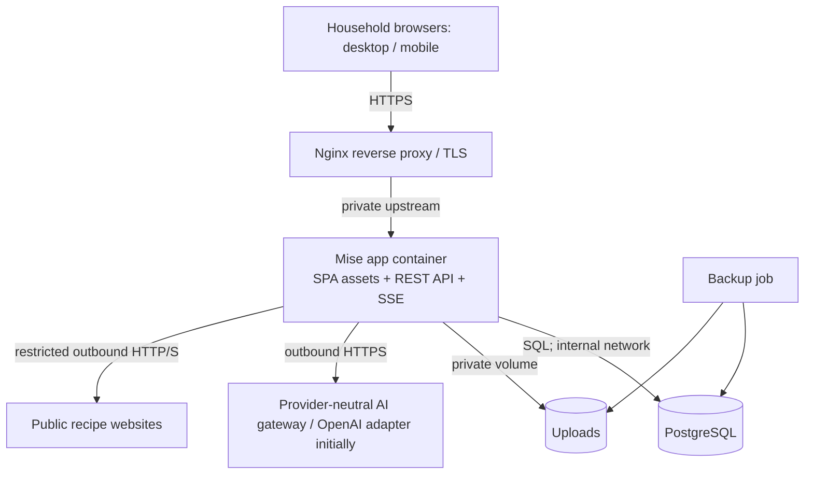

# Mise — Technical Architecture & Design Specification

**Version:** 1.1 — frozen architecture baseline  
**Date:** 27 October 2026  
**Status:** **Frozen architectural baseline**; implementation validation and milestone-level detailed designs remain open. Changes to architectural decisions require a new or amended ADR.  
**Requirements baseline:** `docs/product-specification.md` — Mise Product Requirements Specification v2.1  
**Proposed repository path:** `docs/technical-architecture.md`

> **Document convention**  
> **Confirmed** means derived from the approved product specification. **Recommended** means a technical design proposal, not yet approved. **To decide** identifies a choice to resolve before the relevant implementation milestone. No P1 feature is implicitly promoted into the MVP by this document.

## 1. Purpose and guiding principles

This document translates the approved Mise v2.1 product requirements into an implementable architecture for a private, internet-accessible household application. It establishes module boundaries, storage contracts, data and concurrency rules, AI orchestration, security controls, deployment strategy and verification approach. It is deliberately more concrete than the product specification but stops short of a complete database migration or OpenAPI contract.

**Confirmed constraints:** two household members with individual accounts; shared canonical recipes, meal plans and shopping lists; individual health-related planning profiles; a dedicated recipe importer and meal-planning conversation; Finnish conversational and recipe content; English UI acceptable for MVP; responsive mobile access; safe public HTTPS hosting; user-approved AI changes; optional future MCP integration; P0 includes full-text recipe search, persistent per-occurrence scaling, individualized portions and real-time shopping checkoffs.

**Architectural principles**

1. **Modular monolith, one repository.** A single deployable application backend, one frontend and one relational database. Separate modules in code, not network services.
2. **Database is authoritative.** Neither AI output nor conversation history is a source of truth for approved recipes, plans, portions, schedules or shopping state.
3. **Deterministic domain operations.** Schema validation, authorization, serving conversions, versioning and shopping calculations run in application code, not within an LLM response.
4. **Approval boundaries.** AI may prepare drafts and propose changes; sensitive writes require the user's explicit instruction or approval appropriate to the operation.
5. **Shared cooking, individualized guidance.** One shared dish can serve multiple members with different portion recommendations, absences and leftovers.
6. **Small operational footprint.** No Redis, standalone vector DB, message broker or separate AI container initially. Add only after measured need.
7. **Security and recoverability by design.** Publicly accessible does not mean openly accessible; backup, restore, rate limiting, outbound URL safety and authorization are P0.

## 2. Proposed technology stack

| Layer | Recommendation | Rationale / alternative |
|---|---|---|
| Repository | One private Git repository, TypeScript workspace | Shared types and validation; straightforward development/deployment. |
| Frontend | React + TypeScript + Vite; responsive PWA-capable SPA | Matches prior web-app experience; PWA installability is optional, not an offline-service promise. |
| UI | Tailwind CSS + accessible component library | Accessible mobile shopping controls; all displayed strings through translation keys even if English-only initially. |
| Backend | Node.js LTS + Fastify + TypeScript | Strong runtime validation and explicit HTTP/SSE support; Express or similar is possible. |
| Validation | Zod or equivalent for all boundary payloads | Reuse shared schemas for UI forms, API and AI tool inputs. |
| Data | PostgreSQL + **Drizzle ORM + Drizzle Kit** (approved ADR-002); explicit SQL for PostgreSQL-specific migration features | Transactions, JSONB and full-text indexing; test migration support for custom indexes. |
| Attachments | Private filesystem volume (later pluggable S3-compatible adapter) | Holds source images with backup/restore; never publicly mount raw uploads. |
| AI | Mise-owned provider-neutral AI interface, with OpenAI Responses API adapter initially | Structured outputs, images and tools through workflow-independent contracts; future adapters optional; no MCP server required. |
| Search | PostgreSQL Finnish full-text search + indexed `pg_trgm` fallback + English-compatible search (approved ADR-010) | Search names and Finnish recipe content without another service. |
| Live shopping updates | Server-Sent Events (SSE) plus REST mutations and reconnect snapshot | One-way server notifications meet checkoff requirements with less complexity than WebSockets. |
| Auth | Authelia OIDC; option A: verified passwordless passkey, option B: password + TOTP; Mise-managed opaque, revocable device sessions | Two private household users; replaceable authentication adapter if needed. |
| Reverse proxy | Existing nginx-compatible reverse proxy | TLS termination and routing; app independently authenticates all routes. |
| Packaging | Multistage container build; Docker Compose for app + PostgreSQL | App + PostgreSQL; separate Authelia Compose stack and persistent data, with storage volumes. |

**Version policy:** Pin supported major versions and a lockfile at project initiation; do not hard-code framework or provider-specific model version assumptions in this design. Prefer stable SDK capabilities verified with integration tests.

## 3. System context and deployment topology



**Recommended deployment:** Serve frontend and API from the same origin (e.g. `https://mise.example.tld`) to simplify cookies and CSRF posture. Only port 443 on the reverse proxy is internet-accessible. Mise and Authelia LAN-bound upstream ports must be firewalled to the proxy host IP; do not expose DB or upload-volume ports. Public access requires strong verified authentication (passwordless user-verified passkey or password + TOTP); no VPN. Enable TLS and proxy streaming for AI responses and SSE; ensure proxy buffering is disabled for the SSE route and keep-alive is configured. PostgreSQL and upload storage remain on private Docker networks/volumes. Deploy behind an existing homelab security boundary; do not rely on that boundary as a substitute for application authorization.

**AI independence:** Existing recipes, manual imports/edits, plans and shopping lists continue to function if the configured AI provider is unavailable. AI-specific UI states show retryable failure rather than blocking normal database access.

## 4. Repository layout and module boundaries

```text
mise/
  apps/
    web/                # SPA, pages, reusable components, i18n keys
    server/             # HTTP server, SSE, auth, modules, AI orchestration
  packages/
    contracts/          # Shared DTOs, Zod schemas, enums
    domain/             # Pure scaling, conversions, calendar and validation helpers
  database/             # Drizzle ORM/Drizzle Kit migrations, explicit PostgreSQL SQL where required
  docs/
    product-specification.md
    technical-architecture.md
    adr/                # Architecture decision records
  infra/
    compose.yaml
    nginx-example.conf
    backup/             # scripts and restore runbook
  tests/
    e2e/
    fixtures/
  .env.example
```

Backend modules: `auth`, `households`, `profiles`, `schedules`, `recipes`, `recipe-import`, `cooking-history`, `meal-plans`, `shopping`, `conversations`, `ai`, `assets`, `admin/operations`.

Use **HTTP handlers → application services → repositories → PostgreSQL**. Chat tools and UI endpoints use the *same application services*, never duplicate business logic. Cross-module interaction uses typed service interfaces; avoid importing another module's raw database queries from UI controllers or model-tool handlers. Shared pure domain utilities may be imported directly.

## 5. Core domain model and persistence

All primary entities have opaque UUIDs, `created_at`, `updated_at` where relevant, and a `household_id` when scoped to a household. All queries check membership/ownership at the service boundary. Use PostgreSQL transactions on multi-entity operations; foreign keys and constraints enforce consistency.

| Entity / aggregate | Key fields and relationships | Invariants |
|---|---|---|
| `users`, `device_sessions` | user ID, Authelia OIDC subject, per-device opaque session digest, created/last seen, sliding + absolute expiry, revocation | No Mise password hashes; sessions are individually revocable and only two provisioned subjects are accepted. |
| `households`, `household_members` | household ID, membership role | Both users share recipes, plans and lists; only assigned members may access. |
| `member_profiles` | user/household, birth year or age, height/weight if provided, goal, activity level, preferences and restrictions | Individually editable; minimize access and logging. |
| `recurring_schedule_entries` | member, weekday/time, recurrence, office/exercise/event type, effective range | Omission means **unknown**, not necessarily no activity. |
| `schedule_exceptions` | member, local date/time, replacement/cancellation/addition, attendance effect | Week overrides do not alter recurring pattern. |
| `recipes` | stable ID, household, active/archived, current_version_id, provenance | Exactly one canonical current version per shared recipe. |
| `recipe_versions` | recipe ID, version no., author, reason, timestamp, immutable JSON with `schema_version`, cooking ingredients/steps/yield | Historical cooking state immutable; tags, general notes and archive status mutable on `recipes`. |
| `cooking_events` | member, recipe/version, cooked_at, tested, rating 1–5 nullable, notes | Ratings/events are separate from canonical recipe edits. |
| `import_drafts` | owner, type, source reference, extraction JSON, warnings, state, version | Draft must be reviewed before saving canonical recipe. |
| `assets` | household, controlled relative storage key, mime, size, checksum | No raw public URL to private uploaded files. |
| `meal_plans` | household, start/end local dates, status, revision | Any seven-day window; partial-week support. |
| `meal_slots` | plan, local date, slot type, status, revision, no whole-slot leftover link (component-level linkage only) | Container only; cooking versions and yields live on components. |
| `meal_participants` | meal slot, member, attendance (`home`/`away`/`not_eating`/`unknown`), away-energy estimate/override | One row per member and slot; participation is separate from per-component quantity. |
| `component_member_portions` | component × member, serving equivalents or practical amount/unit, energy estimate, override | Per-member recommendation for each component, including recipe-free sides. |
| `meal_components` | meal slot, type (`recipe`/`simple_accompaniment`), optional recipe version, label, amount/unit, participants, display order | A meal can include a saved recipe and standalone sides (e.g. cucumber, lettuce, cherry tomatoes) that do not need recipes. |
| `shopping_lists` | household, name, status, `change_seq` | List-level monotonic sequence is an SSE sync cursor, never a write conflict token. |
| `shopping_items` | list, origin (`user`/`generated`), key, quantity/unit, category, picked flag, user_modified, item revision | Same-plan generated contributions may combine; user-entered rows remain independent. |
| `shopping_item_sources` | shopping item → plan import, slot, component, ingredient quantity contribution | One generated row can preserve many source contributions. |
| `shopping_import_batches` | list, source plan/revision, approval, provenance; generated item associations | Enables review and safe reconciliation after plan changes. |
| `conversations`, `messages` | household, member, workflow (`planner`/`importer`), ordered turns, status | Persistent chat threads; do not treat messages as approved plan state. |
| `ai_usage_records`, `audit_events` | workflow/model cost units/errors; actor, action, record ID, date | Keep sensitive payloads out of logs by default. |

### 5.1 Recipe ingredient representation

Store structured ingredient lines inside immutable `recipe_versions` (JSONB) initially; every version has a `schema_version`. Each line has a **stable line ID**, optional group, original display name, optional Finnish-lemma normalized ingredient key, original quantity text, numeric minimum/maximum when parseable, canonical unit and display unit, preparation note, optional alternatives, and scale policy (`linear`, `round_to_whole`, `to_taste`, `not_scalable`). Store directions as ordered steps. This keeps imported text faithful while allowing proportional scaling. Preserve the quantity and unit as entered or extracted from the source recipe (e.g. `5 tomatoes` stays `5 tomatoes`; `500 g tomatoes` stays `500 g tomatoes`). Do not convert recipe ingredient units merely to make portions more pragmatic. For recipe scaling, apply a factor to the original numeric quantity when appropriate, while retaining the original unit and sensible rounding. Use decimal/rational calculation and friendly fraction presentation. Finnish units include `rkl`, `tl`, `kpl`, `prk`, `ps`, `dl`, `maun mukaan`; do not infer unknown package volumes or convert weight/count/volume. Household ingredient staples and manual category overrides are keyed to normalized ingredients. Preserve original source values even when deriving normalized values.

### 5.2 Recipe versioning and editing

Updating canonical content creates a new `recipe_version`, atomically updates `recipes.current_version_id`, and requires the caller's expected current version. On stale edits return `409 Conflict` with current revision metadata; do **not** silently overwrite another user's changes. Basic conflict detection is P0; advanced visual conflict resolution is P1. Archived recipes remain referenced by historic plans and events. A restore creates a **new** version copied from a prior one rather than altering history.

### 5.3 Full-text search, including Finnish

**Approved ADR-010:** Use a same-transaction updated `recipes.search_document` sourced from the current version and mutable metadata, with PostgreSQL Finnish full-text configuration, `simple` configuration for English, and indexed `pg_trgm` fallback for typos and compounds; do not scan historical version JSONB. PostgreSQL full-text search can help with ranking; **Finnish language support must be tested** because stemming/tokenization differs from English. A pre-implementation spike with about 30 Finnish/English golden query–recipe pairs validates and tunes ranking, indexes and morphology details; keep ä/ö distinct in primary Finnish indexing. Tests must prove `carrot` finds ingredients in English recipes and corresponding Finnish terms find Finnish recipes. No external Elasticsearch/Meilisearch service in P0.

## 6. Planned meals, portions and scaling — critical invariants

A recipe is not a planned occurrence. Distinguish:

- **Canonical recipe version:** source yield, ingredients and directions.
- **Ephemeral recipe-page preview:** user's selected yield in browser state; no database modification.
- **Planned meal occurrence:** a container slot with one or more components. Each recipe component pins `recipe_version_id`, base/target yield **upon plan approval**, not at draft creation. The slot tracks participants; leftovers link at component level (`leftover_source_component_id`), never at slot level.
- **Simple accompaniment:** a meal component without a recipe record (e.g. salad greens or `10 cherry tomatoes`). Its suggested quantity is stored on that planned meal, not added to the recipe bank.

**Recommended calculation contract:**

```text
factor = target_yield / base_yield
scaled_quantity = source_numeric_quantity × factor
```

Round only for presentation and according to each ingredient's policy; avoid scaling “to taste” as a numeric value. Never change cooking temperatures or times automatically without explicit, explainable logic. For scaled recipe ingredients, retain the source units and use sensible rounding for countable items (e.g. whole eggs or tomatoes); warn when rounding materially changes the planned yield. Pragmatic units for additional accompaniments are a separate concern and must not rewrite the underlying recipe.

**Consistency rule, per recipe component:** `sum(member_portions_in_base_serving_equivalents) + leftovers_in_base_serving_equivalents ≈ target_yield`. Differences outside a configurable tolerance are flagged for review rather than silently corrected. Store recipe-participant serving equivalents where known. For recipe-free accompaniments, store user-facing quantities (e.g. `10 cherry tomatoes`, `5 cm cucumber`) and optional normalized quantities only when useful; do not require a numeric recipe-serving equivalent for a side item. Calorie estimates are separate nullable metadata with method and provenance; never use approximate calorie data to quietly rewrite the approved target yield.

**Example:** A canonical recipe yields four portions. Tuesday's meal is saved with target yield three and pinned version 5. On Tuesday, opening the calendar's recipe link displays three-portion ingredients even if version 6 became canonical meanwhile. A user may edit *only that slot's* yield to 3.5, triggering a reviewable shopping impact. Opening the recipe from the recipe bank defaults to the current canonical recipe and offers a temporary servings converter.

**Shopping coupling:** Approved plan items are generated from pinned recipe versions + approved occurrence target yields **and** the planned quantities of recipe-free accompaniments, not live canonical content. When the plan changes after list generation, mark associated import batch `stale` and offer a **diff/reconciliation review** (`add/remove/adjust`) that preserves unrelated and already-picked items. No automatic duplicate addition or destructive replacement; same-import generated contributions may combine by normalized key/unit only.

## 7. Profiles, nutrition and schedule engine

**Storage:** Both household members can view each other's full profiles. Separate household defaults from each member's editable restrictions, preferences, goals and activity data. Support age/year of birth, weight, optional height, typical exercise level and goal descriptors with explicit consent; treat as sensitive household profile fields.

**Scheduling:** Model recurring weekly schedule entries and date-specific exceptions. Build an effective weekly view by applying exceptions over recurrences; use local dates and Europe/Helsinki as an initial household-configurable timezone default. Store true event instants in UTC plus IANA timezone where time matters; never derive meal-local dates from UTC alone.

**Unknown data:** A missing office or exercise recurrence means unknown. During plan creation, when required information is absent and not supplied for that week, the planner asks concise clarification questions before final approval. `away` is not equivalent to `not_eating` and must not generate an at-home cooking portion by default.

**Nutrition approach (MVP; approved ADR-007 — hybrid):** Calculate member daily energy targets in application code from a documented, published adult estimation method, activity and goals, with conservative limits and capped target changes that the LLM cannot override. Nutrition/portion recommendations remain approximate, goal-aware and nonclinical. Estimate recipe energy once per immutable recipe version using reference ingredient data or a manual override; persist estimate, method, uncertainty, source and coverage. Do not invent calories when quantities are vague, and explicitly handle ingredient ranges. Divide meal-slot energy targets by recipe estimated energy per serving where supported, with pragmatic adjustments. Store estimate method (e.g. `fineli_reference`, `other_ingredient_reference`, `manual`), dataset/version, coverage, confidence/uncertainty and whether inputs are incomplete. A model may assist ingredient matching but is not the authoritative calculator of calorie targets or reliable ingredient energy values. If the nutrient basis is weak, show portion guidance without invented numeric nutritional precision. Use a configurable estimate for `away` meals, with optional correction by the user; include it in the day's estimated total without requiring a food diary. Send mostly derived energy targets, goal direction and restrictions to the AI rather than raw age/weight. Use **Fineli as the preferred reference source**, with a versioned locally stored dataset after verifying format, coverage, licence and attribution requirements. Automatic ingredient matching is best-effort; show ambiguity or incomplete coverage and allow optional manual correction/override **without requiring confirmation for every import**. If matching fails, recipe saving remains possible and nutrition values are unknown or qualified rather than invented. Full micronutrient optimization and mandatory food logging are excluded from P0. Allow manual overrides for both members. For simple accompaniments and individualized serving advice, prefer practical everyday measures (e.g. slices, pieces, centimetres of cucumber). For saved recipe ingredients, preserve the source unit (whether pieces, grams, millilitres or other original measures); scaling must not silently convert it. Not a clinical nutrition product.

## 8. Recipe importer design

```text
URL / photo / pasted text
  -> input validation + guarded acquisition
  -> candidate source extraction
     URL: Recipe JSON-LD first, readable page fallback
     Image: private upload -> vision-capable model
     Text: direct structured extraction
  -> typed draft + provenance + uncertainty flags
  -> editable review screen + potential duplicate warning
  -> explicit Save -> new canonical Recipe v1
```

**URL fetch security:** Allow only `http:` and `https:`; block loopback, private, link-local, multicast and metadata IP ranges for IPv4/IPv6, including after DNS resolution and on each redirect. Pin connections to validated resolved addresses to mitigate DNS rebinding. Set redirect count, time, decompressed-size and content-type limits; disable arbitrary scheme handlers. A separate restricted egress network/proxy is desirable for stronger SSRF isolation. Respect site restrictions, avoid protected/paywalled access, sanitize HTML and never execute page scripts. Many sites' JSON-LD is sufficient; expose fetch failure for copy/paste fallback.

**Model extraction contract:** Use a JSON Schema for recipe title, source yield, ingredient lines, steps, time, tags and `uncertainties[]`. Distinguish sourced facts from inferences; missing quantities stay missing. Store import draft and any source attachment/reference until accepted or deleted, according to retention settings. Save endpoint checks the current draft revision and an explicit `confirmed` action; retry via idempotency key.

**New recipe suggestions:** Planner-generated dishes produce unsaved proposals; on acceptance create a draft through the same validation/review flow. FR-15 conversational draft editing remains P1: MVP uses form fields.

## 9. AI orchestration, tools and conversation memory

**Approved architecture (ADR-008):** Workflow services call a Mise-owned `AiProvider` contract, never a vendor SDK directly. Implement an OpenAI Responses API adapter first; additional providers (e.g. Anthropic, Google) are future adapters. No ChatGPT Project dependency and no MCP server in MVP. Provider selection is server-configurable by workflow and validated against required capabilities.

**Minimal provider-neutral operations:** `generateStructured` (validated JSON/typed result), `runToolTurn` (normalized tool requests/results, with Mise controlling the tool-execution loop), and `extractFromImage` (image input plus extraction output). Normalize messages into Mise roles/content parts and preserve only bounded vendor metadata for diagnostics. Provider adapters report declared support for structured outputs, image input and tool calling; fail configuration validation explicitly if a selected model cannot serve its workflow. Every AI result, including tool arguments, is revalidated with Zod and domain authorization. Provider-specific error codes and usage metrics map to a common internal shape; opaque provider identifiers must not be treated as portable continuation state.

**Scope:** OpenAI adapter and its tests in B/D only; no second adapter, provider-switching UI, automatic failover, cross-provider state transfer, or multi-model orchestration in P0. Add providers by a separate adapter and Finnish regression fixtures for importer/planner.

### 9.1 Workflow separation

| Workflow | Tools available | Write policy |
|---|---|---|
| Planner | `search_recipes`, `get_recipe`, `get_profiles_for_planning`, `get_effective_week_schedule`, `get_recent_cooking`, `get_meal_plan`, `propose_plan`, `propose_plan_patch`, `draft_new_recipe`, `prepare_shopping_addition` | Proposals are separate from approved database changes. Explicit user confirmation/clear instruction before applying plan patch or creating saved recipes. |
| Importer | `create_import_draft` via pipeline; draft validation | Can create *drafts*, never commit canonical recipe without approval. |
| Feedback via planning chat | `find_recipe`, `record_cooking`, `propose_recipe_revision` | Explicit instruction suffices for recording feedback; canonical ingredient/instruction edits require confirmation. |

The server decides which tool set a workflow may use; tool names are not authorization. Every invocation checks membership, schema validation, current version and allowed transition. Cap tool-call depth, API attempts and estimated spend. Client controls initiation and cancellation; cancellation does not roll back already committed user-approved actions, which must be acknowledged.

### 9.2 Conversation context

Persist threads and messages in Mise PostgreSQL. Each request assembles the workflow instructions, relevant recent messages, a bounded conversation summary, household/member preferences and **fresh database facts retrieved through tools**. Do not repeatedly send the full recipe database. For P0, use version-controlled prompts and a short, version-controlled house-rules/reference file; **no user-uploaded AI guideline-document UI or file-search/vector-store integration in P0**. Those may be added in later scope. Keep document provenance and isolate private content. Do not imply the API reads ChatGPT Memory or Projects.

**Prompt-injection defense:** Websites, images and recipe notes are data, never instructions for system behavior or tool authorization. Restrict retrieval text and refuse model requests to reveal keys, bypass validation or invoke unavailable tools. The backend should not treat LLM-supplied household IDs, roles or database identifiers as authorization evidence.

### 9.3 Usage and data controls

Store provider identifier, model identifier, workflow, normalized usage (when reported), request latency and approximate cost in `ai_usage_records`. Maintain a provider-specific pricing/configuration table outside domain entities where appropriate; budget checks are keyed by provider, model and household. Offer per-request limits, household daily/monthly budgets and configurable model choice. Secrets are env/secret-mounted server-side only. Publish clear privacy disclosure: selected profile, diet, activity, recipe and chat data may be sent to the **configured third-party AI provider** for requested tasks. Verify each enabled provider's data-use, retention and regional processing settings before activation; set no-store/retention-minimizing options where supported, recognizing that these controls are not equivalent across providers.

## 10. HTTP API and events — proposed contract

Use `/api/v1` with consistent typed JSON request/response schemas and standardized errors: `{code, message, details?, correlationId}`. Authenticate every route except explicitly public health/login endpoints. All resource lookups verify the actor's household membership from session, **not** from arbitrary client-supplied household IDs.

| API area | Representative endpoints |
|---|---|
| Auth (app routes under `/api/v1`) | `GET /auth/oidc/start`, `GET /auth/oidc/callback`, `POST /auth/logout`, `GET /auth/me`, `GET /auth/devices`, `DELETE /auth/devices/:sessionId`; no Mise password login or change-password endpoints |
| Recipes | `GET /recipes?q=...`, `POST /recipes`, `GET /recipes/:id`, `PATCH /recipes/:id` (`If-Match`), `GET /recipes/:id/versions`, `POST /recipes/:id/restore` |
| Scaling | `POST /recipes/:id/preview-scale` (stateless; optional client-only implementation) |
| Import | `POST /import-drafts` (URL/text/photo), `GET /import-drafts/:id`, `PATCH /import-drafts/:id`, `POST /import-drafts/:id/confirm` |
| Profiles/schedules | `GET/PATCH /me/profile`, `GET/PATCH /household/preferences`, `GET/POST/PATCH /schedules`, `GET/POST/PATCH /schedule-exceptions` |
| Cooking | `POST /recipes/:id/cooking-events`, `GET /recipes/:id/cooking-events` |
| Plans | `GET/POST /meal-plans`, `GET/PATCH /meal-plans/:id`, `PATCH /meal-slots/:id` (`If-Match`), `POST /meal-plans/:id/shopping-preview` |
| Shopping | `GET/POST /shopping-lists`, `GET/PATCH /shopping-lists/:id`, `POST /shopping-lists/:id/items`, `PATCH /shopping-items/:id`, `POST /shopping-lists/:id/import-plan` |
| AI/chat | `GET/POST /conversations`, `GET /conversations/:id/messages`, `POST /conversations/:id/turns` (stream or request status) |
| Events | `GET /shopping-lists/:id/events` (SSE; household authorization) |
| Ops | `GET /health/live`, `GET /health/ready` (minimal info; restrict operational detail) |

**Mutation controls:** For mutable versions use `If-Match` / `revision`; return `409` on conflicts. Apply `Idempotency-Key` to import confirmation, AI-approved actions, shopping plan imports and cooking event creation to protect retries from duplicate effects. APIs for approval should accept *validated proposal IDs*, not arbitrary raw model-generated SQL or mutation payloads.

## 11. Live shopping lists: synchronization and concurrency

**Recommended SSE design:** Clients fetch an initial list snapshot including a monotonically increasing `change_seq`, then open a household-authorized SSE subscription. On item mutation, the server transaction writes the change and increments `change_seq`. It emits a minimal event such as `{listId, seq}`; clients refetch the affected item/list or apply versioned server-authoritative state. On reconnect or revision gap, fetch a fresh snapshot; no need for exactly-once event delivery. Always resync after app resume/visibility changes. A timer-based polling fallback may be used if SSE is unavailable.

**Single instance caveat:** In-process SSE broadcast works only with one application instance. If horizontal scaling is introduced, adopt a DB-backed event/outbox plus `LISTEN/NOTIFY` or broker, without changing public API behavior. Even on one instance, the database is truth; missed SSE events are recovered by re-fetch. Do not rely on notifications as durable storage.

**Simultaneous shoppers:** Checkbox updates set an explicit desired state, not an unsafe `toggle` command. Serialize conflicting writes per row; the last desired-state write committed at server time wins (last-write-wins), and both clients converge to authoritative state. The list `change_seq` is a synchronization cursor, never a conflict token. Show a brief pending indicator and revert/reconcile optimistic state if rejected. Non-checkoff edits with stale revisions use `409` rather than overwriting silently.

**Duplicate policy:** Compatible generated ingredient contributions from the **same plan import** merge by normalized key and compatible units; user-created and separate-import rows stay separate even if labels match. Similarity warnings are advisory; manual cross-origin merges require explicit user approval.

### 11.1 Confirmed merge and reconciliation rules (supersede earlier duplicate language)

- Within **one shopping import batch**, identical normalized ingredient keys in compatible units consolidate to one generated item with `shopping_item_sources` for each contribution; count, volume and mass never merge by guessed conversions.
- Household manually added items are always separate from generated ones, regardless of identical labels; a manual merge requires explicit action. A second import is independent, whereas re-running an existing plan import means revision-aware reconciliation.
- `user_modified` and picked items are never silently adjusted. If a picked item needs more quantity, create an unpicked additional difference row; handle decreases/removals through review. Display staple exclusions in a collapsible list.
- `shopping_lists.change_seq` is only for SSE snapshot freshness; each item has its own edit revision. Checkoff writes express a desired state, are idempotent and use server timestamp precedence. Offline queues are P1.

## 12. Security, privacy and threat model

**Trust boundaries:** internet browser ↔ HTTPS reverse proxy ↔ authenticated app ↔ DB/asset volume ↔ external AI provider and recipe sites. Higher-risk surfaces are login/session handling, URL importer SSRF, file uploads, AI tool misuse, and sensitive personal profiles.

**Minimum security implementation (P0):**

- **CSRF/CORS:** Same-origin UI/API; CSRF tokens and/or strict `Origin` verification on cookie-authenticated mutations; no wildcard credentials/CORS.
- **Authorization:** Every route, asset download, SSE subscription and AI tool execution checks user session + household permission. Query filtering always scopes to household. Never reveal profiles between unrelated households even if only one household is initially deployed.
- **Authentication:** Authelia provides OIDC authorization code + PKCE. Preserve two allowed user-facing paths: **(A)** passwordless FIDO2/WebAuthn passkey with user verification; **(B)** password plus a mandatory TOTP second factor. Both paths must satisfy the agreed assurance level; confirm support and access-control semantics against the chosen Authelia release during an authentication spike. Do not weaken a `two_factor` policy or depend on experimental passkey-policy exceptions to enable (A). If secure passwordless access cannot be verified, ship (B) and retain (A) as a supported architectural option pending later validation. Verify OIDC issuer, audience, nonce, expiry and state; allow only preprovisioned OIDC subjects. App sessions use hashed opaque per-device tokens in `__Host-` Secure HttpOnly cookies with sliding and absolute expiry; list/revoke UI and revocation of active SSE streams. No direct password login in Mise. **Before creating a new application device session, initiate fresh OIDC authentication** (`max_age=0` plus verified `auth_time`, or another tested equivalent) so an existing Authelia SSO cookie cannot silently reissue access after revocation. The app must reject missing/stale authentication evidence under the selected freshness policy; verify actual Authelia behavior for both supported methods. Limit Authelia session persistence where feasible **without breaking the passkey flow**; do not categorically disable Remember Me without testing. Lost-device recovery must separately address Mise sessions, Authelia SSO sessions and compromised credentials/passkeys. Do not introduce a break-glass bypass that can mint trusted sessions in P0.
- **Login abuse:** Authelia login throttling plus reverse-proxy and application rate limits, generic errors, and restricted login surface.
- **Web controls:** CSP and standard security headers, safe HTML rendering and sanitization, dependency patching, upload MIME/size checks and storage outside the web root, no secrets in logs, minimal public health details.
- **Importer egress:** DNS/IP validation before and after redirects, explicit protocol allowlist, restricted outbound networking, timeout/content-size limits; no headless browser in MVP.
- **AI boundary:** Validate tool arguments, allowlist permitted operations, require approval for canonical content edits and stored recipe creation, respect request budgets.
- **Privacy:** Store only requested dietary/profile details; restrict use to the household and intended AI calls; support export/deletion and configurable retention of imported assets and chat data. Encrypt transport; restrict filesystem and DB permissions. Consider disk/backup encryption because profile information can be sensitive.
- **Operations:** Never expose DB admin/admin API or debug ports; secret injection via environment/secrets file with restricted permissions, not committed repo. Maintain a threat-model checklist before public internet release.

**Risk scenarios and tests:** a malicious recipe URL targets local network or cloud metadata; a page tells the model to exfiltrate secrets; one user guesses another ID; stale two-device editing overwrites content; cross-site request forges a checkbox click; old SSE replay mutates state; backup restore loses uploads; repeated AI responses duplicate an import. Each needs a repeatable security/integration test or documented review.

## 13. Reliability, backup, observability and costs

**Backups:** Nightly encrypted off-host backups of PostgreSQL, attachments (if retained), Mise config and Authelia config/volume; proposed RPO 24 hours and RTO a few hours, to verify by scheduled restore drills. Back up PostgreSQL consistently (database dump or coordinated snapshot), attachments and app configuration required for restore; encrypt backup destinations and keep at least one off-host copy. Establish daily schedule and retention during deployment planning. Perform a *full restore rehearsal* onto a fresh test environment before go-live, including account access, pinned recipe versions, plans and uploaded images. Back up migrations/schema together with code version. A backup without tested recovery is insufficient.

**Logging/monitoring:** Structured JSON logs with correlation IDs, HTTP errors, job success/failure, SSE connection counts and AI call costs; no chat transcripts, photos, passwords or detailed profiles in normal logs. Expose health/readiness endpoints; optionally integrate with existing Prometheus/Grafana/Alertmanager stack without making it a new product dependency. Maintain an admin-visible AI cost/usage summary.

**Performance goals (initial targets, validate on hardware):** cached/static pages feel responsive on phones; most ordinary CRUD requests complete in under 500 ms at household scale excluding WAN latency; list checkoffs typically propagate to another active device within 2 seconds on a healthy connection; AI operations show progress and may take longer. Targets are engineering benchmarks, not unmeasured promises.

**Failure modes:** Database unavailable → safe error/no misleading success. Configured AI provider unavailable → manual features work, drafts stay intact. Network interrupted mid-shopping → pending state indicated and resynced. Import URL fails → user can paste text/upload a photo. Background migrations fail → deployment rollback/runbook; do not silently downgrade data schema.

## 14. Testing strategy and traceability

| Layer | Minimum test focus |
|---|---|
| Pure unit tests | Serving arithmetic, unit formatting, rounded ingredients, attendance/leftovers balance, schedule effective week, duplicate suggestions. |
| Domain/service tests | Recipe immutable revisions; restore as new revision; plan pinned versions; shopping diff/reconciliation; authorization and idempotency. |
| API contract tests | Schema validation, auth/CSRF failures, household isolation, expected `409` and retry behavior. |
| AI contract/evaluation fixtures | Finnish plan requests, ambiguous importer values, unsaved recipe suggestion approval, tool injection resistance, expected valid JSON. |
| Integration tests | PostgreSQL migrations, search over Finnish/English terms, file uploads, real plan→shopping additions, fake AI-provider adapter. |
| Browser E2E | Two real sessions/devices marking groceries, reconnect/resync, mobile accessibility, importer confirmation, calendar pinned scaling. |
| Security/regression | SSRF IPv4/IPv6 redirect/DNS cases, upload attacks, role access, login brute-force controls, prompt-injection. |
| Operations | Compose startup, TLS proxy, volume persistence, backup/restore from empty environment. |

**Requirements mapping (representative):** FR-01–07 → Recipes/Versions/Search/Scaling; FR-10–16 → Import + AI; FR-17–19B → Profiles/Schedules/Portions; FR-20–29 → Planner/Conversations; FR-30–32 → Auth/Admin; FR-34–39 → Shopping/SSE. Preserve product acceptance criteria AC-01–AC-18 as full MVP release gates, with automated coverage where practical.

## 15. Incremental delivery plan and exit criteria

All milestones together comprise P0; each should be deployable and independently usable by the household.

| Milestone | Included features | Exit criteria |
|---|---|---|
| **A — Foundations / daily use** | Authelia OIDC (validated passkey or password + TOTP), per-device Mise sessions, household auth, recipe CRUD/versioning/search/scaling, standalone live shopping lists, backup/restore | Both users authenticate and can maintain recipes and concurrently check off groceries on phones; revocation and tested recovery work. |
| **B — Import and feedback** | URL/text/image extraction, review-and-save, provenance, cooking events and ratings | Imported draft requires approval; retries are idempotent and no content is silently invented. |
| **C — Manual planning** | Shared profiles, deterministic nutrition targets, recurring schedules/exceptions, manual calendar, meal components/member portions, leftovers, recipe pinning at approval | One week can be approved with saved scaling and attendance; changes flag downstream shopping effects. |
| **D — AI planning and shopping generation** | Finnish planner chat, staged proposals, new-recipe draft review, plan-to-list batches, provenance merge, reconciliation and cost controls | Plan proposals validate against current plan revision; two recipe onions merge into one generated row while manual onions remain independent; approved edits reconcile safely. |

Out of P0: offline shopping mutation queue, recipe-page chat, conversational importer corrections, extended member analytics and translated UI languages. `Today` view of scaled planned food is in P0 as a useful calendar entry point; step-by-step cook mode and wake lock are P1.

## 16. Architecture decisions (ADR register, frozen v1.0 baseline)

| ID | Status | Decision / qualification |
|---|---|---|
| ADR-001 | Accepted | pnpm workspace, React/Vite, Fastify, TypeScript modular monolith; Zod contracts, Vitest and Playwright; translation keys from the outset. |
| ADR-002 | **Accepted; validation spike** | **PostgreSQL + Drizzle ORM + Drizzle Kit** selected. Validate generated/stored search columns, partial/trigram indexes, transactions, custom SQL migrations and no schema drift. Prisma/Kysely comparison is closed unless a material blocker emerges. |
| ADR-003 | Accepted, implementation review | Self-hosted Authelia OIDC, supporting user-verified passwordless passkey and password + TOTP as design options; select enabled path(s) after checking the release and policy behavior. Every newly issued Mise device session requires verified fresh authentication (`max_age=0` + checked `auth_time`, or tested equivalent), not silent SSO reuse. Retain revocable per-device sessions; recovery covers IdP sessions and passkeys too; no application-side bypass issuance in P0. |
| ADR-004 | Accepted | SSE list-changed events (`listId`, `seq`), REST snapshot refetch, heartbeat, proxy streaming, reconnect/resync and revocation. |
| ADR-005 | Accepted | Draft follows current recipe; recipe component version + yield pinned at approval, revalidated against latest version then. Approved occurrences update only by explicit user choice. |
| ADR-006 | Accepted with restraint | Import images are transient by default; retain source images only by opt-in, strip EXIF and resize where appropriate; backup all retained media. |
| ADR-007 | **Accepted; method/data validation** | **Hybrid nutrition engine**: deterministic safeguarded daily targets; **Fineli-preferred** ingredient reference and version-cached recipe nutrition with provenance/coverage, optional manual override; best-effort automatic ingredient matching with visible uncertainty, not mandatory confirmation. Final formula, safety parameters and dataset integration to be validated. |
| ADR-008 | **Accepted; controlled amendment** | **Provider-independent AI integration:** Mise-owned provider interface, normalized persistent messages/tool events, capability checks and provider/model per-workflow server configuration. OpenAI Responses API is the **sole initial adapter**; later Anthropic/Google adapters may be added after privacy, cost and Finnish workflow tests. Revalidate outputs in Zod, bound tool use and use no-store options where supported. No extra adapters, user-facing provider selector or failover in P0. |
| ADR-009 | Accepted | Encrypted off-host backups and periodic scratch restore test, including Authelia config/data; RPO 24 h, target RTO a few hours. |
| ADR-010 | **Accepted; quality spike** | PostgreSQL Finnish stemmed full-text search plus indexed `pg_trgm` fuzzy/compound fallback and English-compatible search, prioritizing titles then ingredients then instructions/notes. Validate with approximately 30 golden query/recipe cases. |
| ADR-011 | Accepted | Version-controlled prompts and short house-rules file in P0; no upload UI or vector store required. |
| ADR-012 | Accepted | Internet-exposed HTTPS without VPN; separate Authelia Compose stack on Mise host; LAN-only upstream firewall rules, egress controls and security review. |
| ADR-013 | Accepted | Shopping per-item revision for conflicting edits; desired-state checkoff with server-time last-write-wins; per-list monotonic `change_seq` only as sync cursor. |
| ADR-014 | Accepted | Deterministic context pack; AI planning in stages; tools for recipe lookup and proposals; reject stale proposals using plan revision. |
| ADR-015 | Accepted | Ingredient range/group/original units + normalized key, stable lines, scale policy, staples, category override and source-preserving import. |
| ADR-016 | Accepted | Draft/approved/archived plan; proposed/approved/cooked/skipped slot; Europe/Helsinki local dates, leftover source links and shopping staleness. |
| ADR-017 | Accepted | Merge compatible same-import generated contributions, preserve source links; user-added rows separate; second import separate; picked/user-modified rows protected by reviewable reconciliation. |

### 16.1 Milestone-specific implementation gates (not all blockers for migration `0001`)

**Milestone A — before implementing/deploying foundational schema and public access:**

1. Validate selected Drizzle/Drizzle Kit PostgreSQL migrations and indexing, and run approximately 30 Finnish/English search golden cases (ADR-002/010). Do not reopen the technology selection absent a demonstrated blocker.
2. Prototype Authelia OIDC network/issuer handling, passwordless passkey and password + TOTP assurance, **fresh-login request and ID-token `auth_time` verification**. Explicitly test that after Mise device-session revocation the same device cannot silently recreate a session using a live Authelia SSO session. Check revocation of open SSE streams, recovery, and any Remember Me/passkey dependencies (ADR-003/012).
3. Fix ingredient identities/quantities and shopping row origins, source links and revision controls in Milestone A schema/API planning, anticipating D without implementing D features (ADR-013/015/017).
4. Define Zod-generated OpenAPI and idempotency for Milestone A operations (recipe create/edit and shopping writes); add other endpoint/workflow contracts in their implementation milestones.

**Milestone B — before releasing the AI importer:**

5. Define and enforce hard configured AI-provider usage budget, rate/request caps and exhausted-budget behavior for the importer; test retries, provenance and approval idempotency. **Do not defer the initial AI budget until D.**

**Milestone C — before releasing profile-based manual planning/nutrition:**

6. Validate published adult energy equation, conservative safeguards, activity assumptions, Fineli format/licensing/attribution and nutrition estimate reliability with fixture tests (ADR-007). This is **not a blocker for the first Milestone A migration**.

**Milestone D — before releasing AI weekly planning:**

7. Revisit AI spend caps for planner usage and validate staged proposals, plan-revision checks, shopping reconciliation, and approval/idempotency contracts.

### 16.2 API contract gaps to resolve in implementation

Add explicit endpoints for plan proposal apply/reject and approval transitions, ingredient-source shopping reconciliation review/commit, device-session list/revoke, recipe export and admin operations. Generate OpenAPI from shared Zod contracts. Data exports should include portable JSON and Markdown recipe exports. Shopping item desired-state checkoffs must not be blocked by unrelated row changes.

## 17. External references

- Mise Product Requirements Specification v2.1 (`docs/product-specification.md`) — governing internal source.
- OpenAI API documentation: [Responses API](https://platform.openai.com/docs/api-reference/responses), [Function calling](https://platform.openai.com/docs/guides/function-calling), [Images and vision](https://platform.openai.com/docs/guides/images-vision), [File search](https://platform.openai.com/docs/guides/tools-file-search).
- [OWASP Application Security Verification Standard](https://owasp.org/www-project-application-security-verification-standard/), [OWASP Server-Side Request Forgery Prevention Cheat Sheet](https://cheatsheetseries.owasp.org/cheatsheets/Server_Side_Request_Forgery_Prevention_Cheat_Sheet.html).

---

**Changelog:**
- v0.1 (26 October 2026) — First technical architecture and design draft grounded in approved product specification v1.0.
- v0.2 (26 October 2026) — Clarified preservation of original recipe ingredient units and added recipe-free meal accompaniments with pragmatic quantities and shopping-list support. Framework and ADR choices remain proposed.

- v0.3 (26 October 2026) — Incorporated owner decisions and design-review recommendations; aligned to product spec v1.2.

## Change log

- **v0.4 (27 October 2026):** ADR-003 authentication refinement: retained passwordless user-verified passkeys and password + TOTP as alternative sign-in designs, subject to a real Authelia policy/security spike; unchanged OIDC, public HTTPS and revocable-session architecture.

- **v0.5 (27 October 2026):** Approved ADR-002 PostgreSQL + Drizzle ORM/Kit; ADR-007 Fineli-preferred hybrid nutrition and automatic best-effort matching; ADR-010 Finnish FTS + pg_trgm + English search. Reframed the remaining spikes as validation rather than architecture-selection decisions, and aligned baseline to product spec v1.4.

- **v1.0 (27 October 2026):** Frozen architecture baseline; corrected OIDC endpoints, component-level leftovers, shopping desired-state last-write-wins and Drizzle description; excluded AI document upload UI from P0; introduced mandatory fresh-authentication/revocation security prototype and milestone-specific A/B/C/D validation gates.

- **Editorial correction (27 October 2026, no architectural change):** aligned requirement baseline references to spec v2.1, corrected the slot-level leftover wording to component level, and removed vendor-specific wording from the trust boundaries and test table.

- **v1.1 (27 October 2026):** Controlled amendment of ADR-008 to a vendor-independent AI contract with an initial OpenAI adapter. Normalized tool/message/usage handling, capability checks, workflow configuration and provider-specific privacy/cost validation. Core scope and deployment milestones unchanged.
